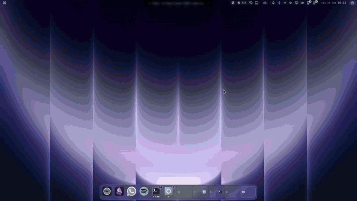

<div align="center">

# Smart Windows

**Windows-style window management for Omarchy.**
Everything floats, drag to an edge to snap, Super + A to tidy up the screen.



</div>

Omarchy tiles every window. Smart Windows turns Hyprland into a floating desktop
that organizes itself the way Windows and macOS do. You drag windows around with
the mouse, and the screen stays tidy without you managing a layout.

## Why this one

- 🪟 **Aero Snap, done right.** Drop a window with the pointer on the top edge to
  maximize it, on a side for half the screen, in a corner for a quarter. Drag it
  away and it gets its old size back, under the same spot of the pointer.
- 🧠 **Smart halves.** A window snapped next to one that already takes 60% of the
  screen gets the remaining 40%, not an overlap. Snap a window to one half and every
  other window on the screen lines up on the other half, stacked (two columns from
  four on): snap assist without the picker.
- ↔️ **Windows resize together.** Resize a window and the ones touching it follow
  the edge; the ones it runs into make room, down to a minimum size, and none of them
  ever grows over a third window. Close or minimize one in a layout and its neighbours
  grow into the hole.
- ✨ **Super + A arranges the screen**: one window maximized, two side by side,
  three as one big plus two stacked, four or more in a grid. Each window takes the
  spot nearest to where it already is (the big spot goes left or right, whichever
  moves things least), so a screen that's almost tidy isn't shuffled. Super + right
  click (without dragging) does the same. Press it again, before you move anything,
  and everything goes back where it was.
- 📐 **New windows land in free space** instead of on top of what you are working
  on, when there is room for them. Dialogs keep their centred place.
- 💾 **Apps remember their size and place.** Close an app and it reopens where it
  was. On another screen (laptop vs. external monitor) it is scaled to fit.
- ➖ **Minimize with an animation.** Super + M slides the window down into the dock
  and hides it; bringing it back slides it up to the same spot, even after a config
  reload.
- ⏏️ **Quit the app, not just the window.** Super + Q ends the app; Omarchy's
  Super + W still only closes the window. Web apps only close their own windows,
  since they share one browser process, and in a terminal Super + Q only closes that
  terminal (each one is its own session).
- 🖥️ **Multi-monitor friendly.** Drag windows across screens freely: borders shared
  with another monitor have a thin snap zone, so crossing doesn't snap. A window
  dropped past a screen edge comes back inside (and shrinks if it is too big).
- 🏝️ **Knows the notch.** With [Island Notch](https://github.com/hugorolimf/omarchy-island-notch),
  snapped windows start below the notch instead of under it.
- 🧊 **Pairs with [Glass Dock](https://github.com/hugorolimf/omarchy-dock).**
  Snapped windows stop above a visible dock; while a window is maximized the dock
  hides like on macOS, and the window grows into the room it leaves.

## Install

```bash
git clone https://github.com/hugorolimf/omarchy-smart-windows
cd omarchy-smart-windows
./install.sh
```

`install.sh` copies two files and reloads Hyprland:

- `~/.config/omarchy-smart-windows/windowing.lua`: the module, with its settings at the top.
- `~/.local/state/omarchy/toggles/hypr/hugorolimf-windows.lua`: a three-line loader.
  Omarchy runs every `.lua` file in that folder on each Hyprland reload; the loader
  only runs the module if it is still there, so removing it can never break your
  config.

Your own `hyprland.lua` and bindings files are not edited.

## Usage

| Action | How |
|---|---|
| Move a window | Super + drag (Omarchy's binding) |
| Resize a window | Super + right drag |
| Maximize | Drop it with the pointer on the top edge |
| Half / quarter of the screen | Drop it on the left or right edge / in a corner |
| Unsnap | Drag it away from where it snapped |
| Arrange the screen (again to undo) | Super + A |
| Minimize | Super + M |
| Quit the app | Super + Q |
| Close only the window | Super + W (Omarchy's) |

Minimized windows live on the hidden `special:minimized` workspace. Bring them back
from [Glass Dock](https://github.com/hugorolimf/omarchy-dock) (click the app) or
[Glass Alt+Tab](https://github.com/hugorolimf/omarchy-alttab), which lists them.
Without either, show that workspace with
`hyprctl eval 'hl.dispatch(hl.dsp.workspace.toggle_special("minimized"))'` and move
the window back with Super + Shift + a workspace number.

Every window that was tiled when the module loads becomes floating, keeping its
place and size.

## Requirements

- Omarchy with Hyprland's Lua config (`~/.config/hypr/hyprland.lua`). Tested on
  Hyprland 0.56.2.
- Optional: [Glass Dock](https://github.com/hugorolimf/omarchy-dock) and
  [Glass Alt+Tab](https://github.com/hugorolimf/omarchy-alttab).

No packages are installed and no system file is touched.

## Configuration

Open `~/.config/omarchy-smart-windows/windowing.lua`; the settings are in the block at the
top. Run `hyprctl reload` after changing them.

| Setting | Default | What it does |
|---|---|---|
| `GAP` | `8` | Space in px between snapped windows and the screen border |
| `ZONE` | `36` | How close to a screen edge (px) the pointer must be to snap |
| `SHARED` | `4` | The same, on a border shared with another monitor |
| `CORNER` | `0.22` | Share of a side, next to a corner, that snaps a quarter |
| `MIN_W`, `MIN_H` | `160`, `100` | Smallest size a neighbour gives way to |
| `MINIMIZE_MS` | `230` | Length of the minimize slide, in ms |
| `KEYS.quit` / `.minimize` / `.arrange` | `SUPER + Q` / `M` / `A` | Set one to `false` to leave the key alone |
| `KEYS.maximize` | `false` | A key for maximize / restore, e.g. `"SUPER + CTRL + M"` |
| `MONITOR_WORKSPACES` | `{}` | Pin workspaces to monitors, e.g. `{ ["DP-1"] = { 1, 5 }, ["eDP-1"] = { 6, 10 } }` |
| `KEYS.arrange_click` | `true` | Super + right click (without dragging) arranges like Super + A |
| `DOCK_STATE_DIRS` | Glass Dock's folders | Where a dock publishes the height it covers |
| `NOTCH_STATE_DIRS` | Island Notch's folder | Where a notch publishes the height it takes at the top |
| `LOG_MOVES` | `false` | Log every automatic move to `~/.local/state/omarchy/windowing.log` |

Super + Q, Super + M, Super + A and Super + Ctrl + M are not used by Omarchy's
default bindings. If you bound them yourself, change them here.

### Files it keeps

In `~/.local/state/omarchy/`:

- `windowing-geometry`: the last size and place of each app, by window class.
- `windowing-minimized`: where minimized windows go back to.
- `windowing.log`: only with `LOG_MOVES = true`.
- `io.github.hugorolimf.dock/maximized`: maximized windows, only if Glass Dock's
  state folder exists.

## Integration API

The module defines these global Lua functions. Anything can call them with
`hyprctl eval`, for example a dock, a title bar button or a key binding. Addresses
are written the way Hyprland prints them (`0x55d0c3a1b2c0`).

| Function | Does |
|---|---|
| `windowing_raise(address)` | Focus a window and bring it above the others |
| `windowing_minimize(address)` | Minimize a window (slides down, then hides) |
| `windowing_minimize_active()` | Minimize the active window |
| `windowing_maximize([address])` | Maximize or restore the given window, or the active one |
| `windowing_close()` | Close the active window |
| `windowing_quit([class])` | Quit an app by window class, or the active window's app |
| `windowing_refit(monitor)` | Refit maximized windows on a monitor (e.g. after a dock shows or hides) |
| `windowing_arrange()` | Super + A |
| `windowing_fit(address)` | Bring a window back inside its screen |

[Glass Dock](https://github.com/hugorolimf/omarchy-dock) detects
`windowing_raise` and then uses `windowing_raise`, `windowing_minimize`,
`windowing_quit` and `windowing_refit` instead of plain dispatchers. It also stops
reserving space at the bottom, because snapped windows already stop above it.

Title bar buttons, for example with the hyprbars plugin:

```lua
hl.plugin.hyprbars.add_button({ bg_color = "rgb(ff5f57)", fg_color = "rgba(00000099)", size = 12, icon = "×", action = "hyprctl eval 'windowing_close()'" })
hl.plugin.hyprbars.add_button({ bg_color = "rgb(febc2e)", fg_color = "rgba(00000099)", size = 12, icon = "−", action = "hyprctl eval 'windowing_minimize_active()'" })
hl.plugin.hyprbars.add_button({ bg_color = "rgb(28c840)", fg_color = "rgba(00000099)", size = 12, icon = "+", action = "hyprctl eval 'windowing_maximize()'" })
```

If your title bar is drawn above the window rather than over it, set the global
`TITLEBAR_HEIGHT` to its height in your config, so snapped frames include it.

## Uninstall

Bring back any minimized windows first, then:

```bash
./uninstall.sh
```

It deletes the loader, `~/.config/omarchy-smart-windows/` (with your settings) and the
state files above, then reloads Hyprland. New windows tile again; windows already
open stay floating until you toggle them (Super + T) or log in again.

By hand:

```bash
rm -f ~/.local/state/omarchy/toggles/hypr/hugorolimf-windows.lua
rm -rf ~/.config/omarchy-smart-windows
rm -f ~/.local/state/omarchy/windowing-{geometry,minimized} ~/.local/state/omarchy/windowing.log
hyprctl reload
```

## Pairs well with

- [Glass Dock](https://github.com/hugorolimf/omarchy-dock): minimize to the dock, a
  dock that hides behind maximized windows.
- [Glass Alt+Tab](https://github.com/hugorolimf/omarchy-alttab): Alt+Tab with live
  thumbnails, including minimized windows.

## License

[MIT](LICENSE) © Hugo Rolim Filho
